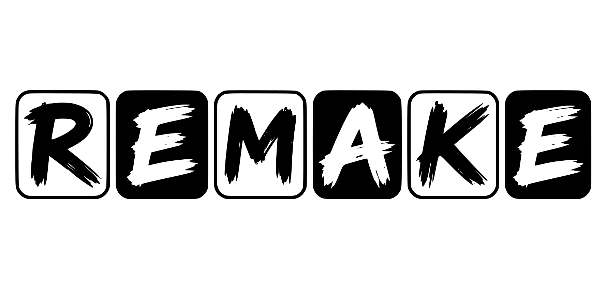

# REMAKE



REMAKE is a **36-key wireless split keyboard** designed by **Felipe Balbi**
around RMK firmware. Its name includes **RMK**.

Each half has 15 finger keys and a three-key thumb cluster. The stepped board
outline follows the column stagger and thumb fan. Both halves use the same
reversible PCB: manufacture **two separate, identical boards** and populate
them in opposite orientations. No panelization or mouse bites are required.

## Revision validation status

| Revision | Status |
|---|---|
| REV 0.1 | Fully validated |
| REV 0.2 | Verified on hardware; in active use |
| [REV 0.3](https://github.com/6mil-Labs/remake/releases/tag/v0.3) | Current prerelease; physical validation remains required |

> **REV 0.3 is prototype hardware, not production-fit or safety certification.** The current design has
> **18 keys per half / 36 total.** Routing is complete, ground pours are filled,
> and the outline is closed with straight runs and circular fillets, with at least
> **3.5 mm nominal switch-body margin** around the key matrix. SW17's
> larger PCB envelope contains a **26.5×16.5 mm cap**, rotated
> 90° relative to its original thumb fan; other caps use **17.5×16.5 mm** envelopes.
> The minimum nominal thumb-to-row gap is approximately **0.660 mm**.
> Production tolerances and moving-key fit have not been physically validated.
> Component selection and physical validation are incomplete. The battery
> receptacles moved **4 mm upward** to improve lead reach. **PCB v0.3 uses
> Case v1.0**, not Case v0.2. Firmware is maintained and tested separately.

## v0.3 release and editable sources

- [Published v0.3 prerelease](https://github.com/6mil-Labs/remake/releases/tag/v0.3):
  fabrication ZIP, schematic PDF, assembly PNG/STEP previews, Case v1.0 left/right
  STEP bodies, model-coverage notes, and `SHA256SUMS`.
- [Tagged v0.3 sources](https://github.com/6mil-Labs/remake/tree/v0.3): editable
  KiCad project/schematic/PCB and FreeCAD case sources. GitHub's source archives
  on the release page contain these files; Gerbers and STEP exports are not a
  replacement for the editable sources.

Use two identical PCBs per keyboard. Keep assembly models (`remake-*.step`)
separate from case bodies (`case-v1.0-*.step`), and review model omissions and
physical-fit requirements before fabrication or assembly.

## Repository layout

| Path | Contents |
|---|---|
| [`hw/`](hw/) | KiCad project, schematic, PCB, local libraries and library tables |
| [`cad/`](cad/) | Component models, source manifest and third-party notices |
| [`docs/`](docs/) | Assembly, manufacturing and component references |
| [`docs/assets/`](docs/assets/) | Vector logo and source artwork |
| [`.github/workflows/`](.github/workflows/) | KiCad checks; no automatic source commits |

The root contains project-level documentation and licensing. Generated reports
and exports belong in ignored output directories, not alongside source files.

## Open the hardware

Use **KiCad 10.0.7 or newer** and open [`hw/remake.kicad_pro`](hw/remake.kicad_pro).
Local library tables and project-relative model paths travel with the project.

On this machine, use the following workaround for the native Wayland issue:

```sh
GDK_BACKEND=x11 kicad hw/remake.kicad_pro
```

Read [assembly](docs/assembly.md) before building. The
[component reference](docs/components.md) records sources, licences and model
limitations; a rendering is not proof of fit. The regression suite checks
schematic-to-PCB associations separately from electrical parity.

## Firmware

[REMAKE Miryoku](https://github.com/6mil-Labs/remake-miryoku) contains the
RMK-based firmware, complete keyboard configuration, build/flash instructions,
and native tests. It provides left/central and right/peripheral UF2 images;
flash matching builds to both nice!nano v2 controllers. Firmware is versioned
separately from the PCB: use its documented REMAKE pin mapping and check the
actual assembly. Hardware CI does not build or certify the firmware.

## Checks

Run from the repository root, with reports outside the source tree:

```sh
mkdir -p .remake-checks
kicad-cli pcb drc --format json --refill-zones --schematic-parity \
  --output .remake-checks/drc.json hw/remake.kicad_pcb
kicad-cli sch erc --format json \
  --output .remake-checks/erc.json hw/remake.kicad_sch
```

Before fabrication, require clean refilled DRC, zero unconnected items and
schematic parity, and review all ERC findings. Use `--exit-code-violations` for
gated checks. Do not hide findings, weaken rules or bridge selection jumpers
to make checks pass. Component-rating, physical assembly, battery-safety and
prototype/RF checks remain required even when CAD checks pass.

Run the regression suite as well:

```sh
python3 -m unittest discover -s tests -v
```

## Draft releases

Pushing a tag runs the same required CI on that exact commit. Only after CI
and fabrication packaging succeed does the workflow create a **draft** GitHub
Release containing one-design JLCPCB fabrication ZIP, a schematic PDF,
left/right PNG and STEP previews, compatible Case v1.0 body STEP files,
model-coverage notes and checksums. These files are separate attachments, never
additional designs inside the JLCPCB ZIP. The STEP assemblies are partial;
check their coverage notes before case design. Branch/PR CI also exports the
case solids for both case versions as the `case-steps` artifact, including on
case-only changes. PCB v0.3 uses Case v1.0; case and PCB revision numbers differ.
Review and publish the draft manually; failed, cancelled or skipped prerequisites
block release creation. Passing CI is not physical/fabrication approval.

See [manufacturing and release details](docs/manufacturing.md) for archive
contents, validation limits and retry behavior.

## OSHWA certification

REMAKE is **not yet OSHWA-certified**. Open-source licensing, passing CI, and
the generic open-hardware gear logo are not the OSHWA certification mark.

The [submission guide](docs/oshwa.md) documents the standard-library Python
helper, API-token signup, and editable application template. Preview is offline
by default; submitting requires explicit legal declarations and `--submit`.
Point an application at the public source/release version being certified, not
an unpublished future v1.0. Wait for OSHWA approval and a UID before using the
certification mark on a PCB.

## Contributing and licensing

See [CONTRIBUTING.md](CONTRIBUTING.md) for source organization and validation
expectations.

**Copyright © 2026 Felipe Balbi.** REMAKE is licensed under the
**CERN Open Hardware Licence Version 2 — Strongly Reciprocal**
([CERN-OHL-S-2.0](LICENSE)); see [COPYRIGHT](COPYRIGHT) for the project notice.
Project-authored written documentation and original documentation illustrations
are additionally available under [CC-BY-SA-4.0](LICENSE-DOCUMENTATION.md), at
your option. Hardware/design files retain their existing licence.
Imported third-party component models and library sources retain their
documented licences and notices. Local-only models with unresolved
redistribution rights are not covered by the project licence grant.

### Manufacturing and sales

Interested in manufacturing or selling REMAKE boards or kits? I'd love to hear
from you! Please [open a manufacturing and sales issue](https://github.com/6mil-Labs/remake/issues/new?template=manufacturing-and-sales.yml)
to discuss revisions, manufacturing feedback, and opportunities to collaborate.
You can also opt in to a future seller list to help people find bare PCBs, kits,
or assembled keyboards without building everything themselves.

Commercial manufacture and sale are permitted under [CERN-OHL-S-2.0](LICENSE),
subject to its requirements. Contacting the maintainer is encouraged, but is not
a condition of exercising those rights. Third-party products must not be
presented as officially endorsed without permission.
